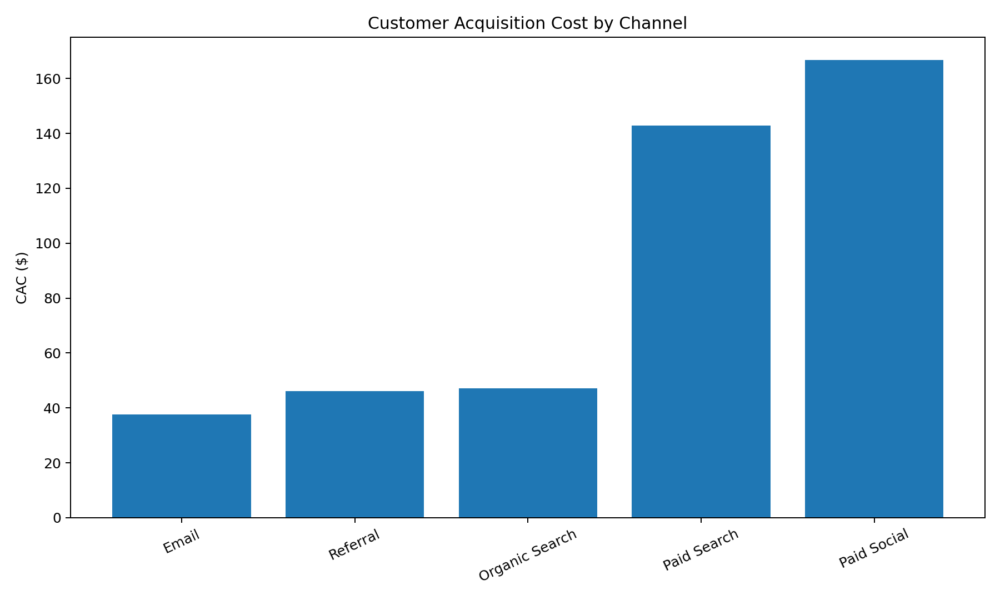
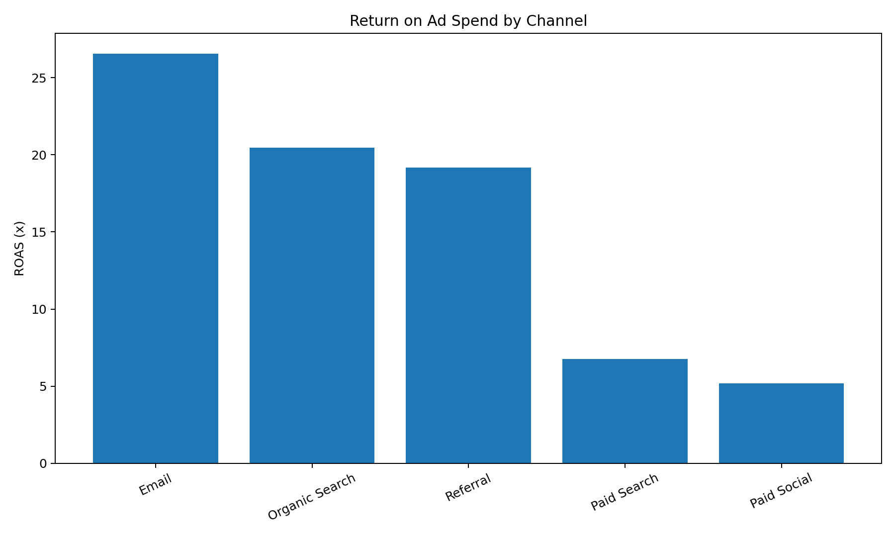
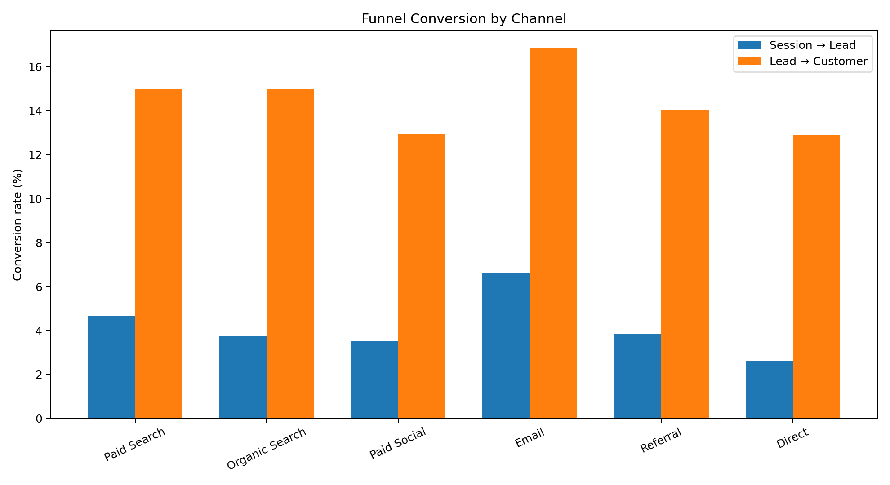

# Marketing Performance Dashboard

## Executive summary

This project demonstrates how I evaluate multi-channel marketing performance across **traffic, funnel conversion, customer acquisition cost, revenue, and ROAS**.

The goal is to move beyond channel-level reporting and answer a more useful business question:

**Which marketing channels are actually creating efficient, scalable growth?**

The analysis compares Paid Search, Organic Search, Paid Social, Email, Referral, and Direct traffic using a common decision framework.

> **Portfolio note:** The dataset is synthetic and contains no confidential company information.

## Channels included

Paid Search · Organic Search · Paid Social · Email · Referral · Direct

## Business questions

- Which channels generate the strongest customer volume?
- Where does the funnel lose efficiency?
- Which paid channels justify incremental budget?
- How should leadership distinguish traffic growth from profitable growth?

## Metrics

- Sessions
- Leads
- Customers
- Session-to-lead conversion
- Lead-to-customer conversion
- CAC
- Revenue
- ROAS

## Visual analysis

### Customer acquisition cost



### Return on ad spend



### Funnel conversion



## Illustrative insights from the sample dataset

- **Organic Search** generates the highest customer volume in the sample data.
- **Email** delivers the strongest ROAS among channels with attributed spend.
- **Email** shows the lowest CAC among channels with attributed spend.
- Funnel performance varies meaningfully by channel, reinforcing the need to evaluate downstream conversion rather than traffic volume alone.
- Organic, Direct, Referral, and Email should be interpreted differently from paid media when comparing acquisition economics.

> The dataset is synthetic and these insights are illustrative. They are included to demonstrate the analysis and decision framework, not to represent employer or client performance.

## Business recommendations

Based on this framework, a marketing team should:

- Allocate budget based on downstream customer economics, not traffic volume alone
- Identify channels with strong top-of-funnel performance but weak customer conversion
- Compare paid-media efficiency using CAC and ROAS together
- Treat Organic, Email, Referral, and Direct differently from paid acquisition when evaluating CAC
- Investigate funnel leakage before increasing spend
- Use channel-level data as an input to budget decisions rather than as a reporting endpoint

## Run

```bash
python analyze_channels.py
```

## Marketing principle

A channel should not be judged on a single metric. Strong marketing decision-making combines **volume, conversion quality, acquisition cost, revenue contribution, and strategic role**.

All data is synthetic and contains no confidential company information.
